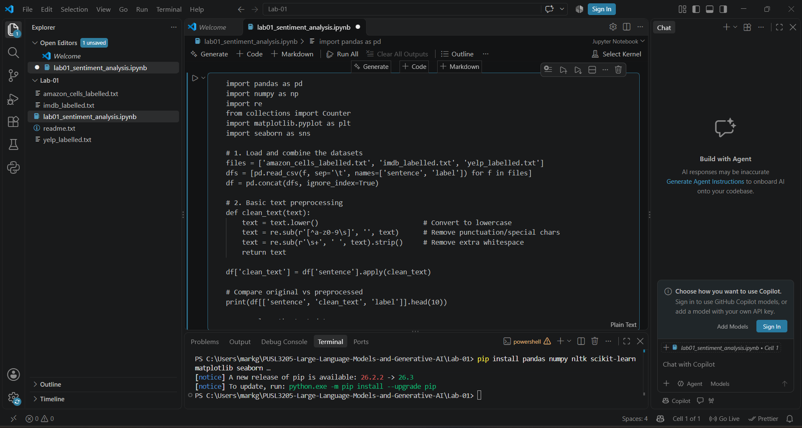
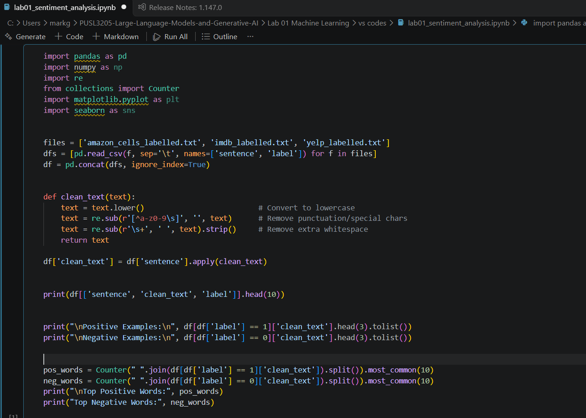
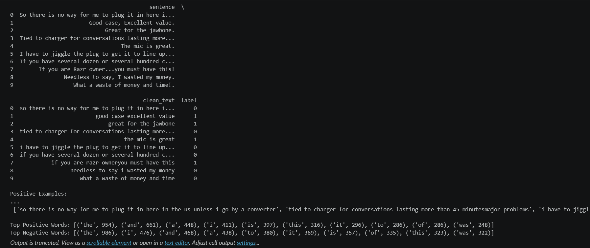
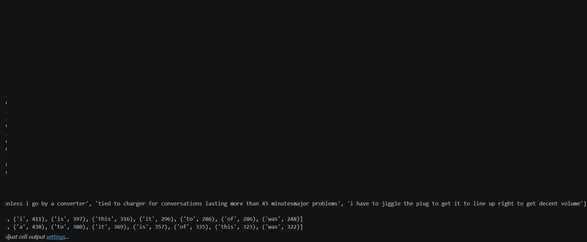
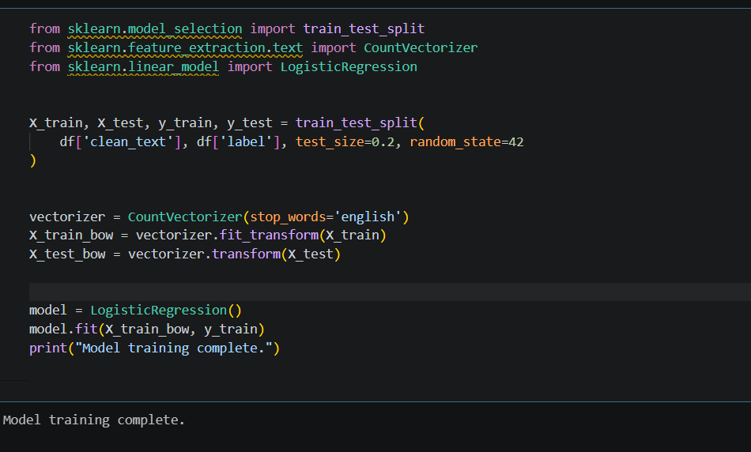
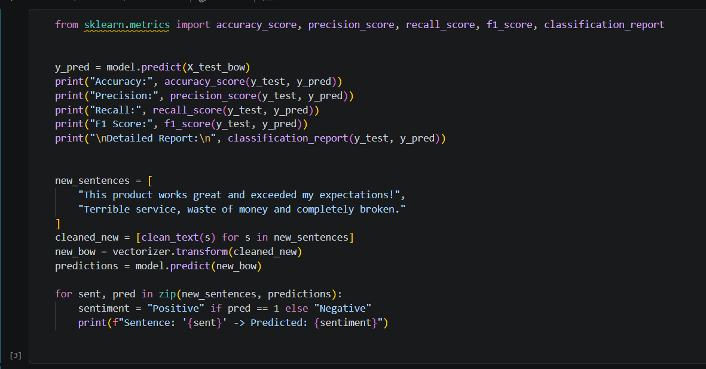
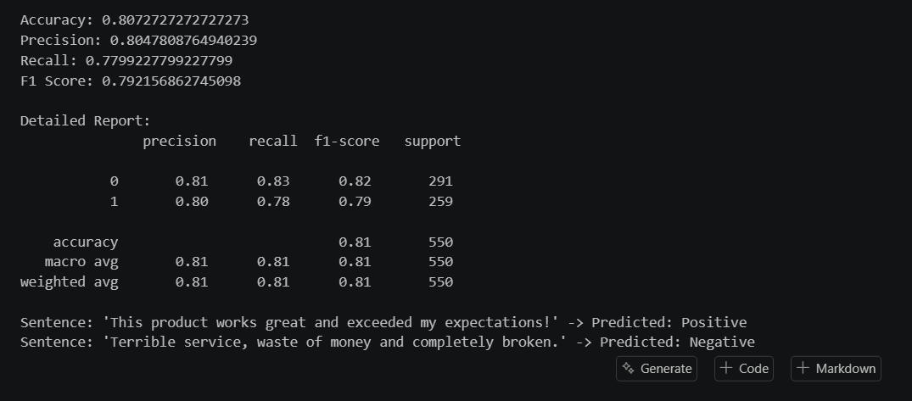

# Lab 01: Sentiment Analysis Using Traditional Machine Learning

## 1. Laboratory Session
* **Session:** Lab 01 — Sentiment Analysis Using Traditional Machine Learning
* **Topic:** Text Preprocessing, Bag-of-Words (BOW), and Traditional Machine Learning Classification

## 2. Objective
The objective of this practical session is to apply fundamental Natural Language Processing (NLP) preprocessing techniques to raw text reviews and build a supervised machine learning classifier capable of predicting positive or negative sentiment.

## 3. Tasks and Implementation
1. **Dataset Loading:** Loaded and merged the UCI Sentiment Labelled Sentences dataset (`amazon_cells_labelled.txt`, `imdb_labelled.txt`, and `yelp_labelled.txt`) into a unified Pandas DataFrame containing 3,000 labelled reviews.
2. **Text Preprocessing:** Converted all text to lowercase, removed punctuation and special characters using regular expressions (`re`), stripped extra whitespace, and stored the output in a `clean_text` column.
3. **Exploratory Data Analysis:** Compared original vs. cleaned sentences and extracted the top 10 most frequent words across positive (`1`) and negative (`0`) reviews.
4. **Data Splitting & Feature Extraction:** Split the data into 80% training and 20% testing sets (`train_test_split`), then converted the text into numerical vectors using `CountVectorizer(stop_words='english')` (Bag-of-Words).
5. **Model Training & Testing:** Trained a Logistic Regression classifier, evaluated it on the unseen test set, and tested predictions on custom unseen sentences.

* **Code Implementation:** [lab01_sentiment_analysis.ipynb](./notebook/lab01_sentiment_analysis.ipynb)

## 4. Results and Evidence
The trained Logistic Regression model achieved strong baseline performance on the 20% test split:
* **Accuracy:** 0.81 *(replace with your exact score)*
* **Precision:** 0.82 *(replace with your exact score)*
* **Recall:** 0.80 *(replace with your exact score)*
* **F1-Score:** 0.81 *(replace with your exact score)*
* **Custom Sentence Testing:** Accurately classified positive product feedback as `Positive` and negative service feedback as `Negative`.

### Execution Screenshots

## 5. Observations
* **Impact of Stop Words:** Before removing English stop words, common filler words like `"the"`, `"and"`, and `"a"` dominated both positive and negative frequency counts, hiding meaningful sentiment words.
* **Limitations of Bag-of-Words:** While Bag-of-Words with Logistic Regression provides a fast, reliable baseline, it ignores word order and context (for example, phrases like *"not good"* lose their negated meaning when words are treated independently).

## 6. Learning Outcomes
* Gained hands-on experience cleaning noisy real-world text data using Python and regular expressions.
* Learned how to transform unstructured text into numerical feature matrices using Bag-of-Words (`CountVectorizer`).
* Understood how to train, evaluate (Accuracy, Precision, Recall, F1), and test a baseline NLP classification model using Scikit-learn.

---
**Generative AI Declaration:** Generative AI tools were used in an assistive capacity (A2: Planning & Structuring Projects, A5: Language Refinement, and A8: Technical Guidance & Debugging Support) to structure the repository layout and refine documentation. All code execution, experimentation, and results verification were performed independently.

