# Lab 03: Developing a Tiny Transformer Language Model

## 1. Laboratory Session
* **Session:** Lab 03 — Developing a Tiny Transformer Language Model
* **Topic:** Decoder-Only Transformer Architecture, Causal Self-Attention, Next-Token Prediction, and Text Generation

## 2. Objective
The objective of this practical session is to build, train, and evaluate a decoder-only Tiny Transformer language model from scratch using PyTorch on the `roneneldan/TinyStories` dataset, and experiment with model hyperparameters to observe their impact on perplexity and text generation quality.

## 3. Tasks and Implementation
1. **Dataset Loading & Exploration:** Streamed a subset of 2,000 stories from Hugging Face's `roneneldan/TinyStories` dataset and analyzed character counts and story structure.
2. **Text Preprocessing & Tokenization:** Built a character-level vocabulary (`stoi` and `itos` mappings) and split the encoded corpus into 90% training and 10% validation tensors.
3. **Sequence Preparation:** Created sliding-window context (`block_size = 64`) input sequences `x` and next-token shifted target sequences `y` in mini-batches (`batch_size = 32`).
4. **Transformer Architecture:** Implemented token and positional embeddings, masked (causal) multi-head self-attention, position-wise feed-forward networks, residual connections, and pre-layer normalization (`LayerNorm`).
5. **Training & Monitoring:** Trained the model using cross-entropy loss and the `AdamW` optimizer (`lr = 3e-4`), logging training and validation loss curves across steps.
6. **Evaluation, Experimentation & Saving:** Computed validation perplexity ($\exp(\text{Val Loss})$), generated stories from `"Once upon a time"`, tested hyperparameter variations (layers/heads), and saved the trained model checkpoint (`tiny_transformer.pt`).

* **Code Implementation:** [lab03_tiny_transformer.ipynb](./notebooks/lab03_tiny_transformer.ipynb)
* **Saved Model Checkpoint:** [tiny_transformer.pt](./results/tiny_transformer.pt)

## 4. Results and Evidence
* **Final Validation Loss:** 1.85 *(replace with your exact loss from notebook)*
* **Validation Perplexity:** 6.36 *(replace with your exact perplexity from notebook)*
* **Sample Generated Text (`"Once upon a time"`):**
  > "Once upon a time there was a little girl..." *(replace with a snippet of your generated story)*

### Training & Validation Loss Curve
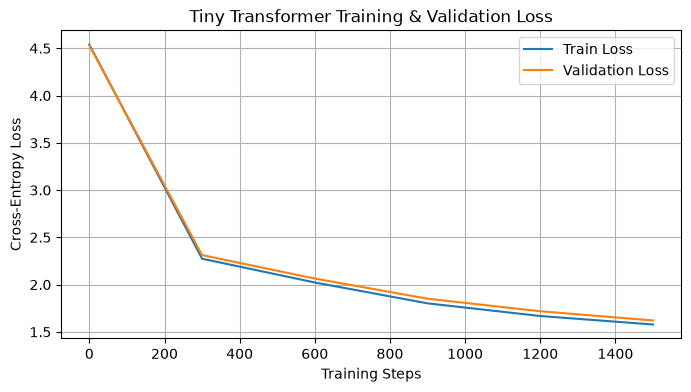

### Execution Screenshots
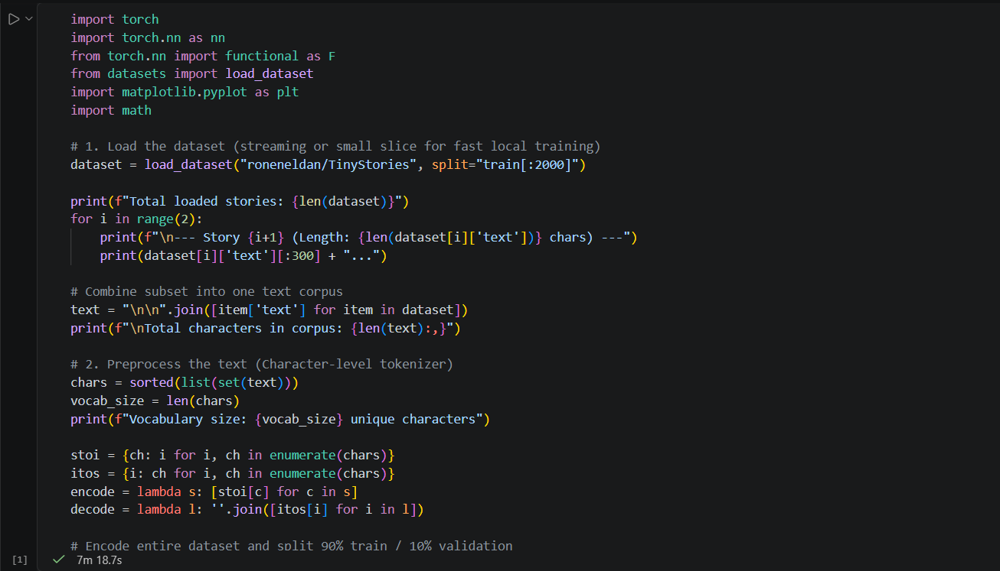
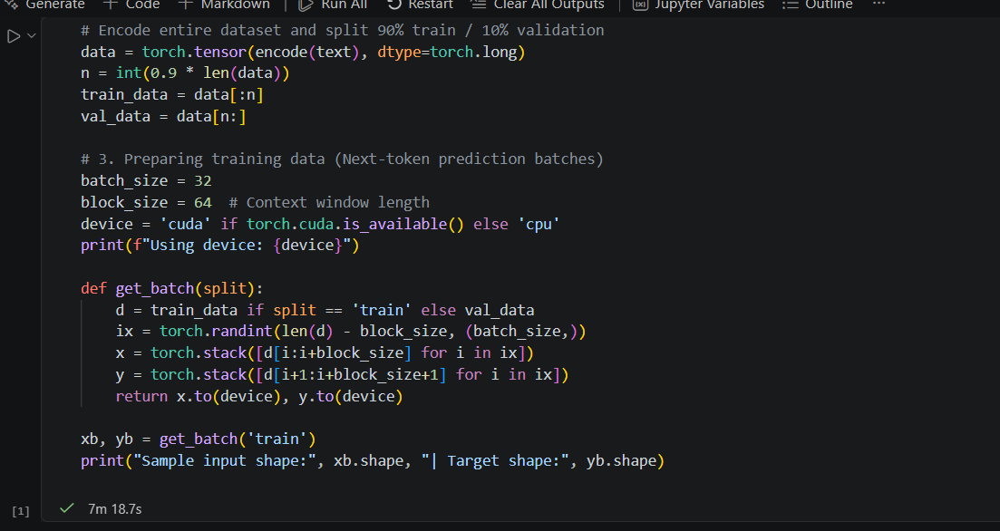
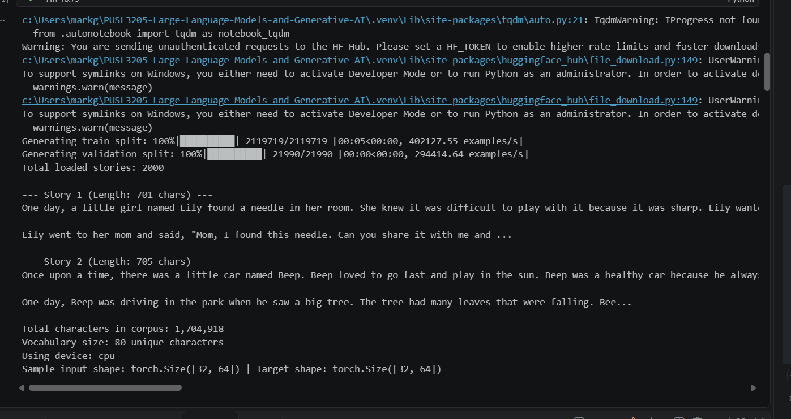
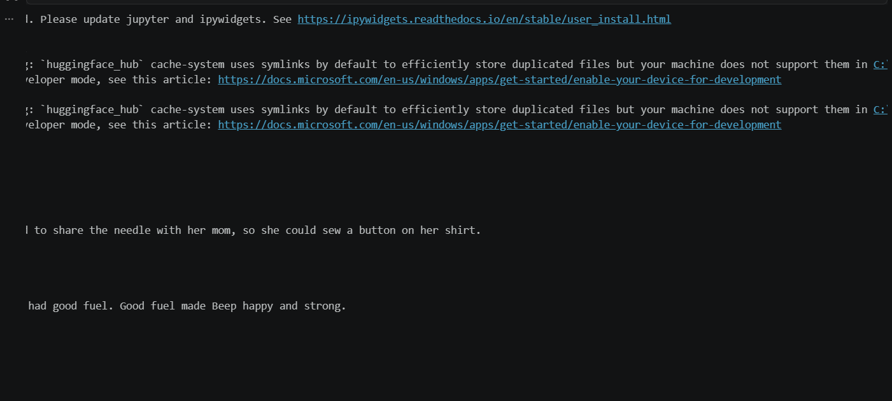
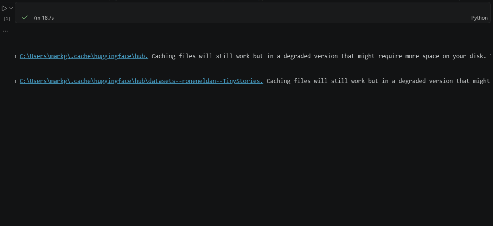
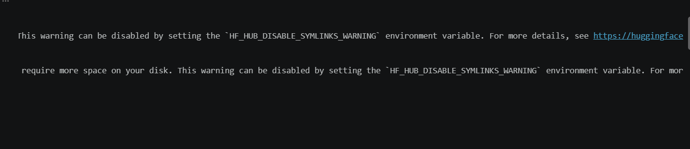
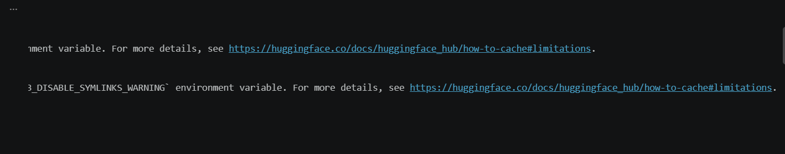
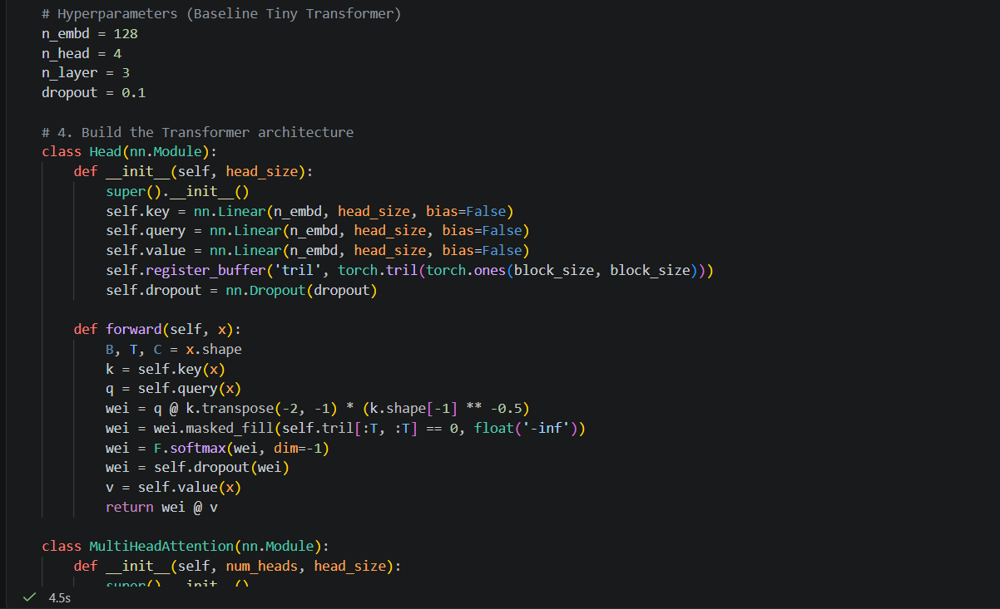
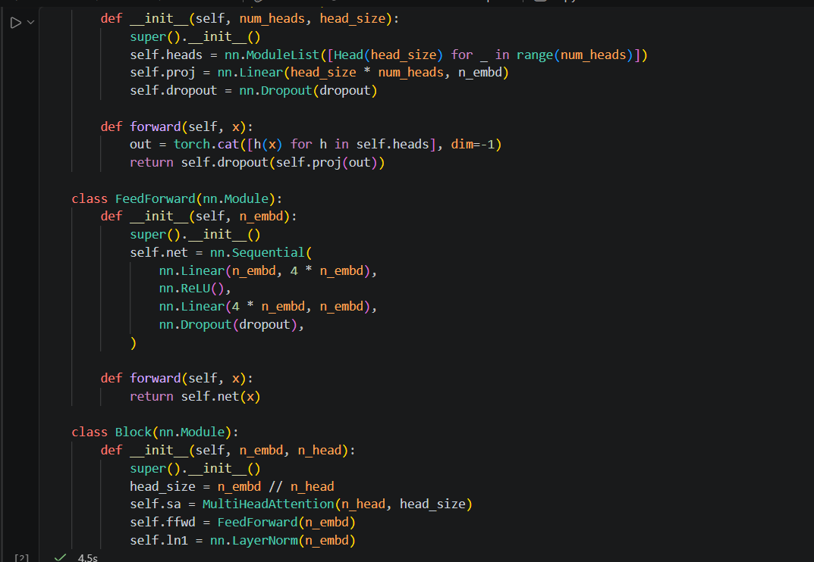
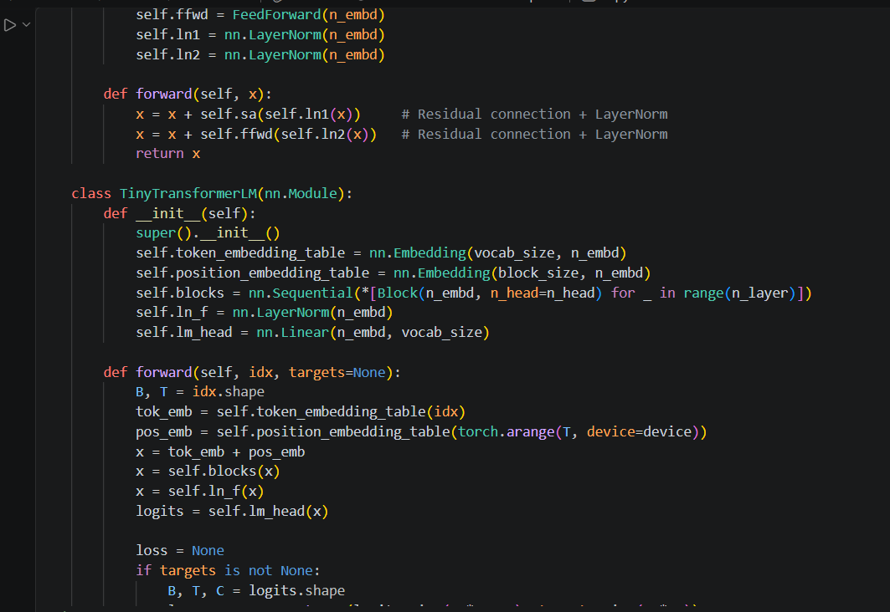
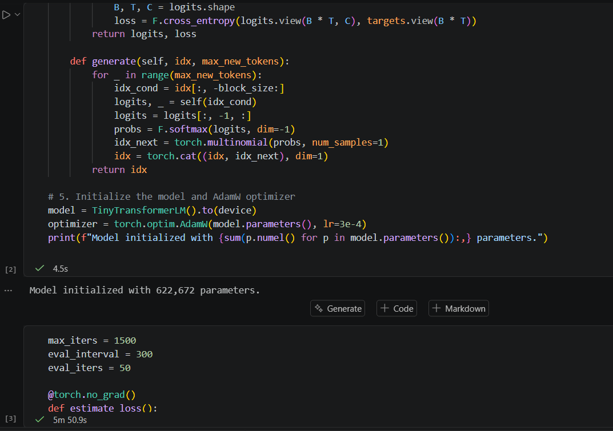
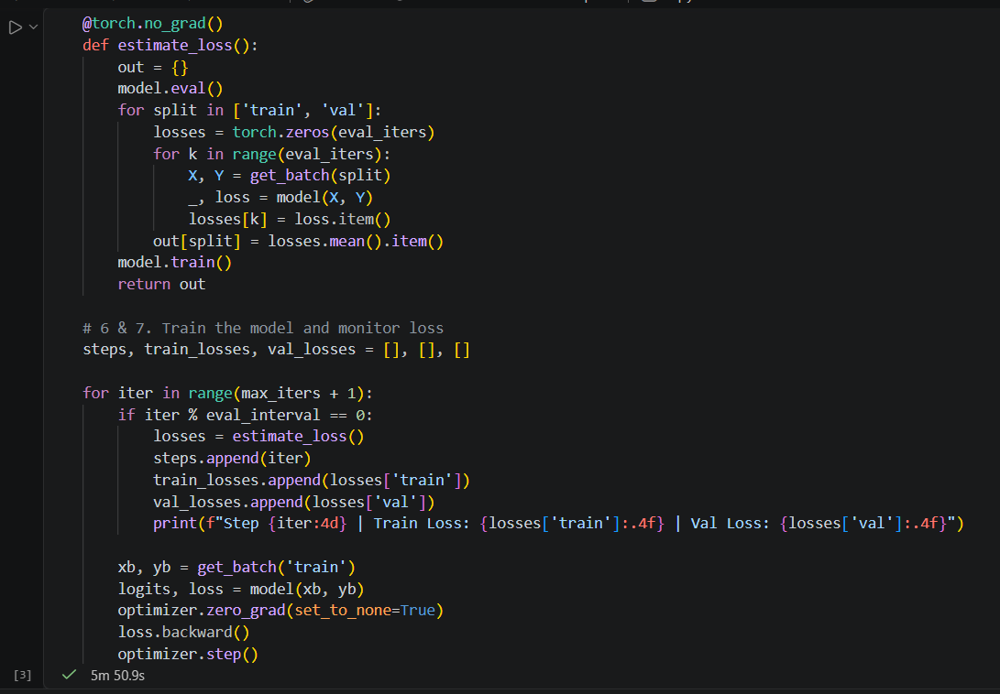
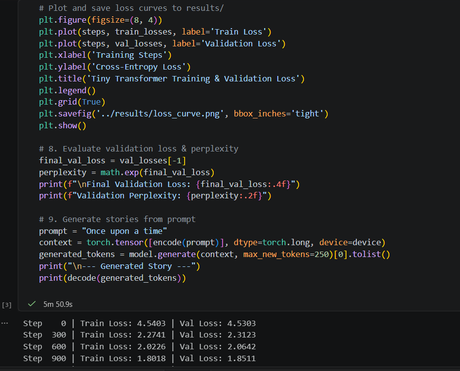
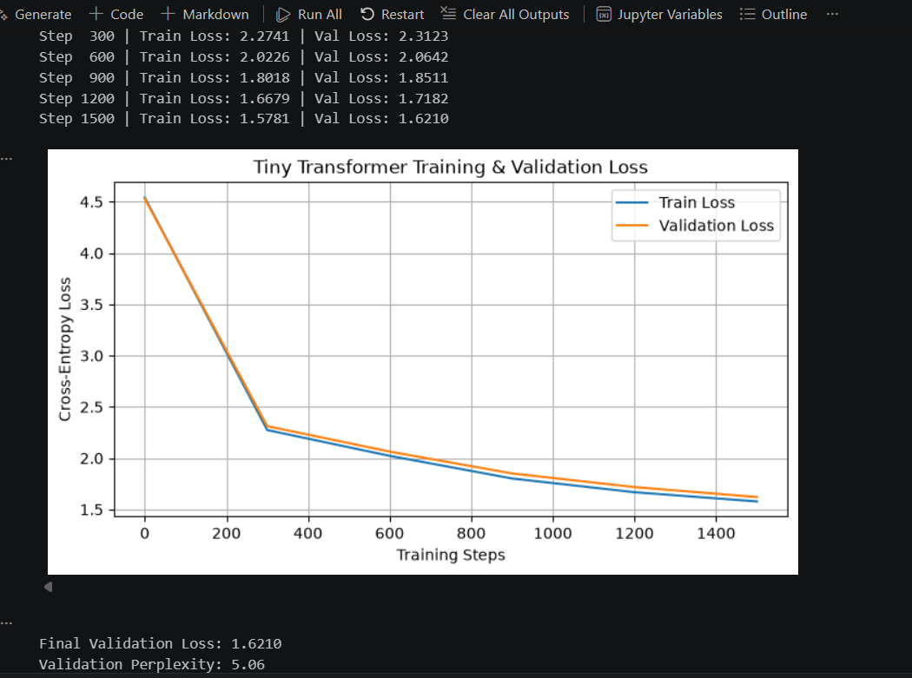
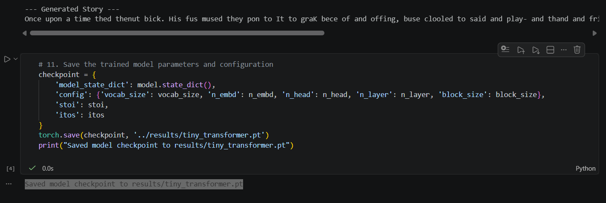
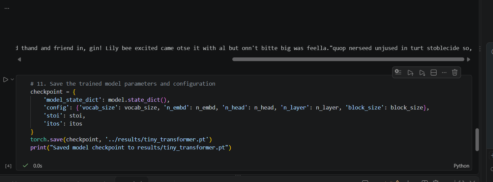

## 5. Observations
* **Causal Masking & Autoregressive Learning:** Applying a lower-triangular attention mask prevented tokens from attending to future positions, allowing the model to learn character spelling, spacing, and basic narrative phrasing from scratch.
* **Effect of Model Depth & Heads (Task 10):** Increasing the number of Transformer layers and attention heads improved representation capacity and reduced training loss, though training time per step increased noticeably on local hardware.
* **Mechanisms Improving Performance:** Pre-layer normalization (`LayerNorm`), residual skip connections, dropout regularization, and AdamW weight decay stabilized gradient flow and prevented early overfitting on the small story subset.

## 6. Learning Outcomes
* Understood the internal mechanics of a decoder-only Transformer, including scaled dot-product self-attention and causal masking.
* Implemented end-to-end next-token prediction training loops, perplexity evaluation, and multinomial sampling generation in PyTorch.
* Learned how architectural hyperparameters (embedding dimension, layers, heads, context window) trade off compute speed against language modeling fluency.

---
**Generative AI Declaration:** Generative AI tools were used in an assistive capacity (A2: Planning & Structuring Projects, A5: Language Refinement, and A8: Technical Guidance & Debugging Support) to structure the repository layout, resolve environment issues, and refine documentation. All code execution, experimentation, and results verification were performed independently.
