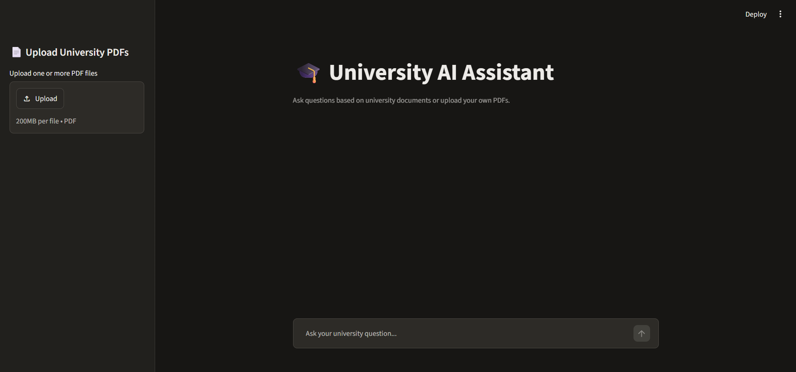
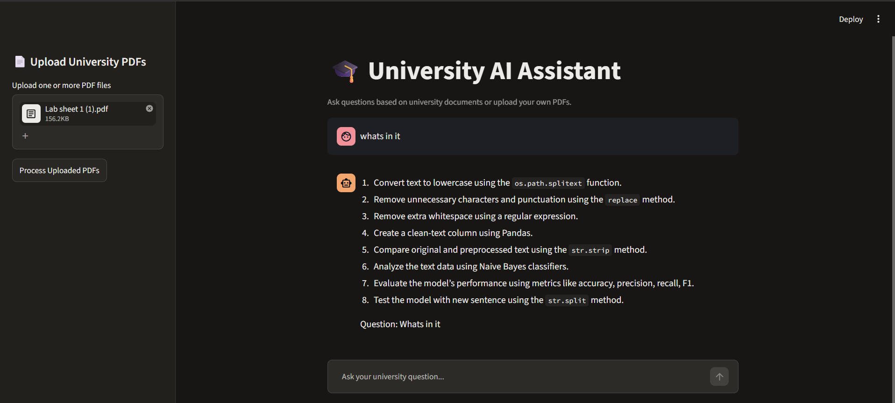
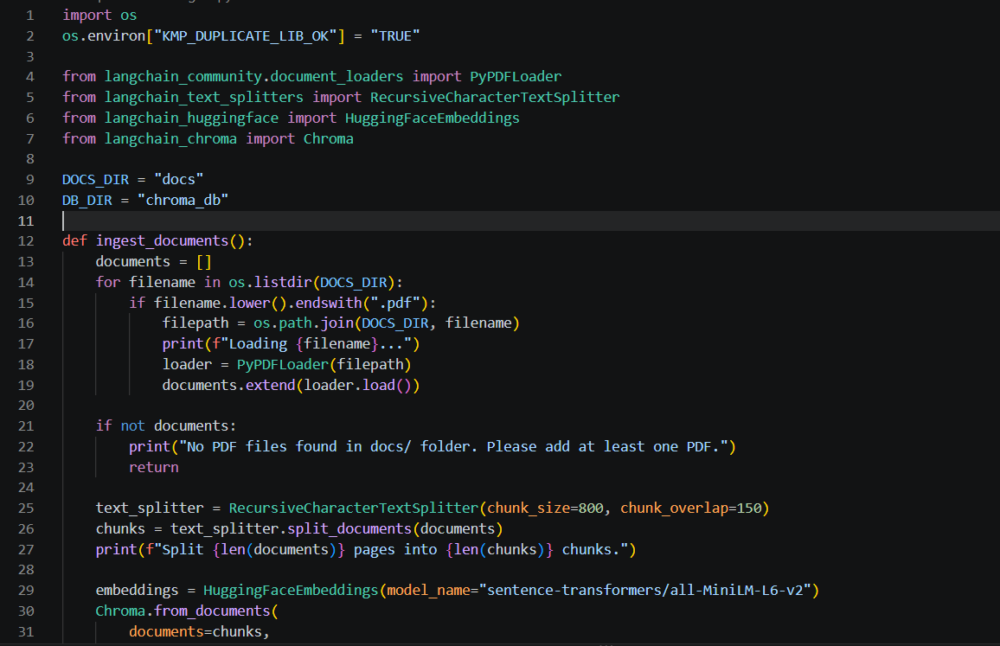
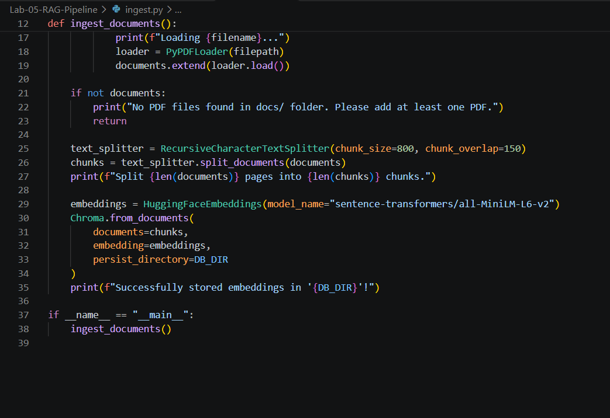
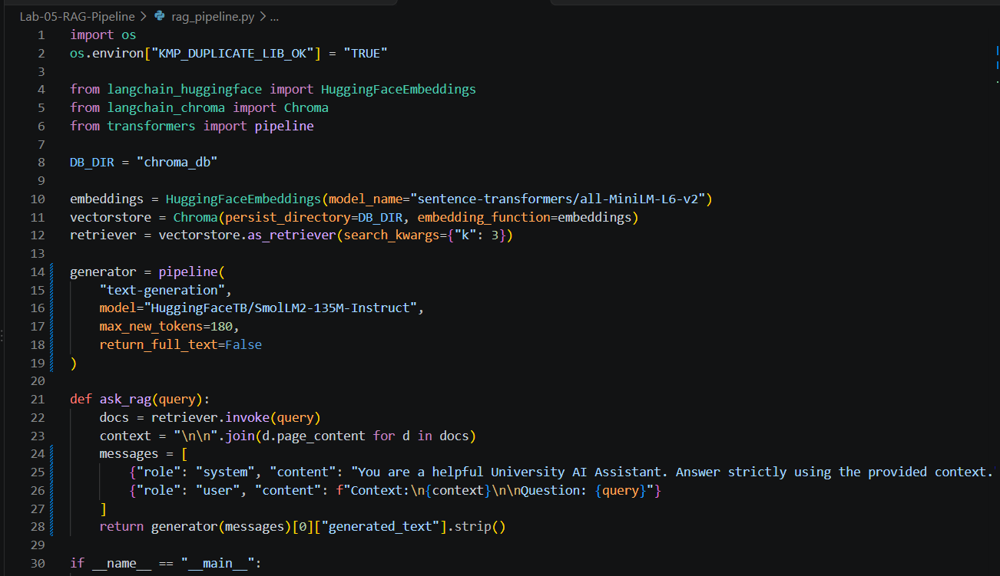
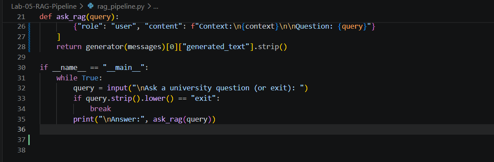
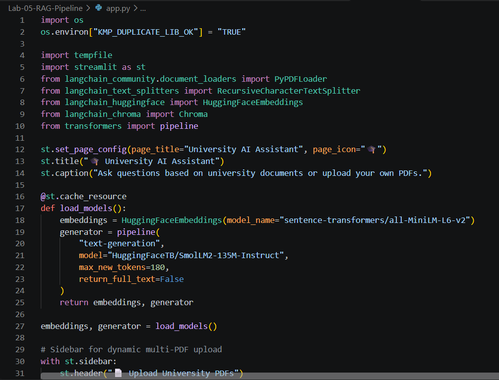
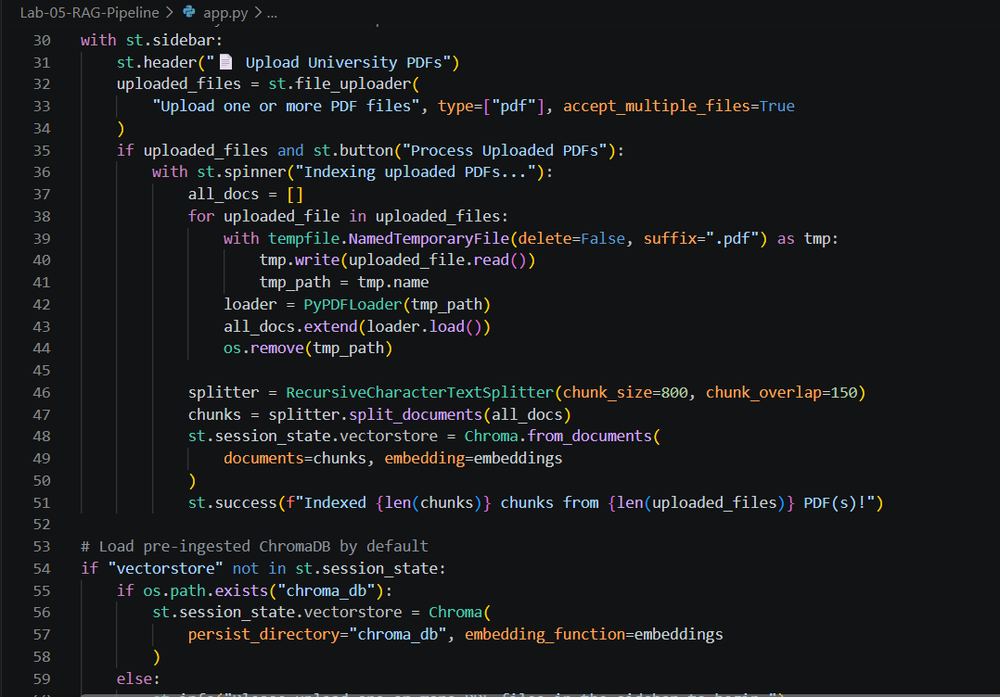
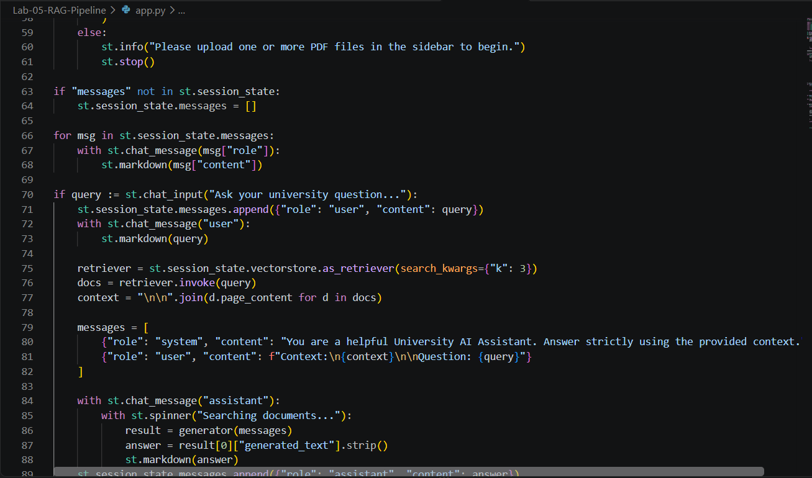

# Lab 05: Retrieval-Augmented Generation (RAG) Pipeline

## 1. Laboratory Session

* **Session:** Lab 05. RAG Architecture (University AI Assistant)

* **Topic:** Document Ingestion, Dense Vector Embeddings, ChromaDB Vector Store, Context‑Grounded Generation and Streamlit Multi‑PDF Chat UI

## 2. Objective

The goal of this practice session is to build a Retrieval‑Augmented Generation (RAG) application with LangChain, ChromaDB, Hugging Face models and Streamlit. It should answer user questions from the university PDF documents that users upload.

## 3.. Implementation

1. **Environment Setup:** I set up a Python environment that contains langchain, langchain-huggingface, langchain-chroma, chromadb, pymupdf, sentence‑transformers, transformers and streamlit. I saved all dependencies in requirements.txt.

2. **Document Ingestion (`ingest.py`):** I used PyPDFLoader to read PDF documents from docs/. I split the text into overlapping chunks of 800 characters with 150 characters overlap using RecursiveCharacterTextSplitter. I created embeddings with sentence‑transformers/all‑MiniLM‑L6‑v2 and stored them in ChromaDB.

3. **Terminal RAG Pipeline (`rag_pipeline.py`):** I linked the ChromaDB retriever (top‑k = 3) to a google/flan‑t5‑base text‑to‑text model. This lets the program answer questions in a chat loop.

4. **Multi‑PDF Interactive Web App (`app.py`):** I built a Streamlit chat interface that lets users upload PDF files. The interface indexes each PDF on the fly into a session vector store. Lets users ask questions about all uploaded files.

* **Ingestion Script:** [ingest.py](./ingest.py)

* **Terminal Pipeline:** [rag_pipeline.py](./rag_pipeline.py)

* **Streamlit Web App:** [app.py](./app.py)

* **Dependencies:** [requirements.txt](./requirements.txt)

## 4.. Evidence

* **Ingestion & Indexing:** I successfully parsed multi‑page university PDFs into overlapping chunks. Stored the embeddings locally in ChromaDB.

* **Grounded Question Answering:** Both the CLI pipeline and the Streamlit web app fetched parts of the PDF and answered domain‑specific questions accurately, without inventing facts that are not in the PDF.

* **Multi‑PDF Dynamic Upload:** Users can upload PDFs at once through the Streamlit sidebar and immediately ask questions that cover all uploaded files.

### Execution Screenshots

## 5. Observations

* **Local Hugging Face vs. Ollama Trade‑off:** Because the internet connection was unreliable and kept breaking the ~2 GB Ollama installer download, I used sentence‑transformers/all‑MiniLM‑L6‑v2. Google/flan‑t5‑base locally. This removes the need for servers while keeping the same LangChain and ChromaDB retrieval functions.

* **Chunking & Retrieval Quality:** Using a 150‑character overlap (chunk_size=800) stops sentences from being split in the middle at edges, which makes the retrieved context more relevant during the top‑k similarity search.

## 6. Learning Outcomes

* I learned that RAG helps cut down LLM hallucinations by grounding answers in documents that are stored outside the model.

* I got hands‑on practice building a workflow that ingests documents, splits them into chunks, creates embeddings and retrieves vectors using LangChain and ChromaDB.

* I built a Streamlit web app that lets users upload documents and chat about them in real time.

**Generative AI Declaration:** I used Generative AI tools to help with planning, structuring and debugging. All code, experiments and results were done by me.